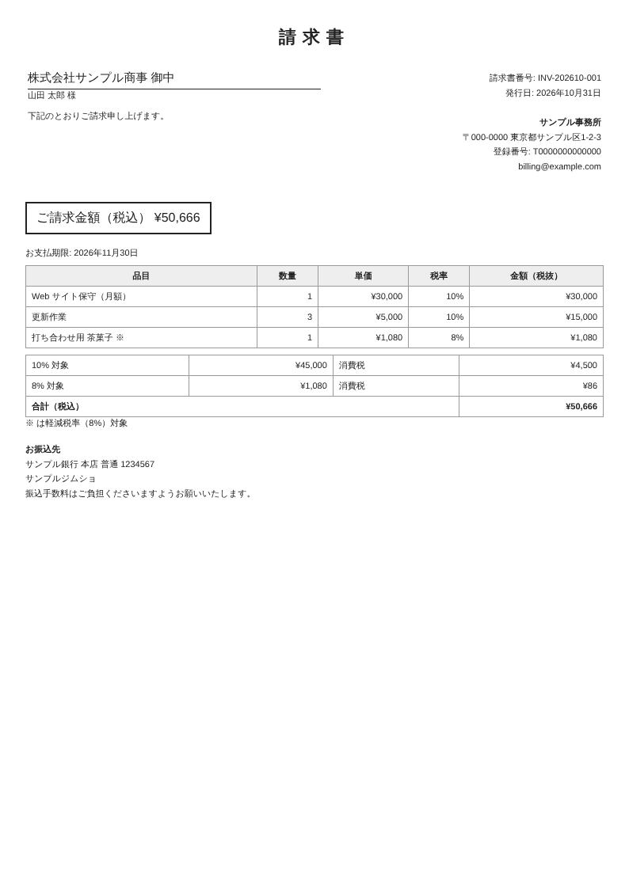

# 請求書 PDF 自動作成ツール（GAS）

スプレッドシートに請求明細を入力してメニューを押すだけで、**顧客ごとの請求書 PDF を作成し、Google ドライブに保存して、PDF 付きの Gmail 下書きまで用意する** Google Apps Script です。メールは自動送信せず、人が確認してから送ります。

> 自主制作物です。実際の業務で使われたシステムではありません。



*テンプレートの見た目（ダミーデータ）。`npm run preview` で生成。実際の PDF は GAS の変換エンジンで作るため、細部が異なる場合があります。*

## 1. 何をするツールか
1. 「請求明細」シートから、指定した月の明細を読み込む
2. 顧客ごとにまとめて、税率ごとの小計・消費税・合計を計算する
3. 請求書番号（例: `INV-202610-001`）をつけて PDF を作り、ドライブの「請求書」フォルダに保存する
4. 顧客のメールアドレス宛てに、PDF を添付した Gmail の**下書き**を作る
5. 「発行履歴」シートに記録する（同じ月・同じ顧客は二重に発行しない）

## 2. 解決する課題
- 毎月、顧客ごとに請求書を Excel や Word で作り、PDF にして、メールに添付する作業に時間がかかる
- 金額や消費税の計算ミス、宛先や添付ファイルの取り違え
- 「どの顧客に何月分を出したか」が追えない

## 3. 主な機能
| 機能 | 内容 |
|---|---|
| 請求書 PDF の作成 | 品目・数量・単価・税率から自動で作成。発行者情報や振込先は「設定」シートから差し込む |
| インボイス制度への対応 | 登録番号の記載、税率ごとの対象額と消費税、軽減税率（8%）対象の表示。消費税は税率ごとに 1 回だけ端数処理 |
| Gmail 下書きの作成 | PDF 添付済み。件名・本文はテンプレートで、会社名や金額を差し込める |
| 二重発行の防止 | 発行履歴にある（請求月・顧客）はスキップ。何度実行しても同じ請求書は 1 回だけ |
| 入力チェック | 明細に 1 行でも不備（存在しない顧客ID、数量が 0 など）があれば、1 枚も作らずに行番号つきで知らせる |
| お試しモード（DRY_RUN） | 確認用 PDF だけを作る。下書きと発行履歴は作らない。初期値は ON |
| 支払期限・端数処理の設定 | 支払期限は「翌月末」「当月末」「◯日後」、端数処理は切り捨て・四捨五入・切り上げから選べる |

## 4. 使用技術
- Google Apps Script（V8）、Google スプレッドシート、Google ドライブ、Gmail
- テスト: Node.js 標準のテストランナー（`node:test`）。外部ライブラリなし
- プレビュー画像の生成: Playwright（任意）
- CI: GitHub Actions（テスト、gitleaks による秘密情報スキャン）

### ファイル
| ファイル | 中身 |
|---|---|
| `src/lib.js` | 計算・入力チェック・請求書の HTML・設定の読み方・サンプルデータなどの純粋関数（Google のサービスを使わない） |
| `src/main.js` | GAS の処理（メニュー、シートの読み書き、PDF の作成、Gmail の下書き） |
| `src/appsscript.json` | 権限（OAuth スコープ）とタイムゾーン |
| `src/selftest.js` | 自己テスト（開発用。**納品物には入れない**）。テスト用のスプレッドシートで、サンプルデータを本番の処理に流して結果をシートに書く（「9. 自己テスト」） |

## 5. セットアップ方法
### かんたんな方法（コピー＆貼り付け）
1. 新しい Google スプレッドシートを作る。
2. 「拡張機能 → Apps Script」を開く。
3. 最初からある `コード.gs` の名前を `main` に変え、中身を `src/main.js` に置き換える。「＋」→「スクリプト」で `lib` を足し、`src/lib.js` の中身を貼り付ける。エディターではファイル名に `.gs` が付き、`main.gs`・`lib.gs` になりますが、それでかまいません。最後に保存する。
   - **貼る前に、エディタの中身を空にする**（右側をクリック → Ctrl+A → Delete）。最初からある `function myFunction() {` や、元の `appsscript.json` の中身が残ると、メニューが出ない・保存できないなどで動きません（2026-10-25 に実際に起きた）。貼ったあと、1 行目に `function myFunction` がないことを確かめる。
   - メニューが出ないときは、Apps Script の上の関数の選択で `onOpen` を選び「▷ 実行」を押すと出ます。ノートパソコンで F5 が音量などのキーになっている場合は、アドレス欄の左の ↻ か Ctrl+R で再読み込みします。
4. 「プロジェクトの設定」（歯車）で「「appsscript.json」マニフェスト ファイルをエディタで表示する」をオンにし、エディターに出た `appsscript.json` の中身を `src/appsscript.json` に置き換えて保存する（権限とタイムゾーンを本番と同じにするため）。
5. スプレッドシートを再読み込みすると、メニューに「請求書ツール」が出る。

### clasp を使う方法
```bash
npm install -g @google/clasp
clasp login
cp .clasp.json.example .clasp.json   # scriptId を自分のものに書き換える（公開しない）
clasp push
```

## 6. 実行方法
1. メニュー「① 初期設定」を実行する（初回は権限の承認が必要）。承認が終わったら、**もう一度同じメニューを押してください**（承認の直後は、押したメニューの処理が動かないことがあります。Google で未確認）。
2. 「設定」シートの黄色いセルに、自社名・住所・振込先などを入力する。
3. 「顧客」「請求明細」シートを入力する（試すだけならメニュー「サンプルデータを入れる」）。
4. メニュー「② 請求書を作成する」→ 請求月（例: `2026-10`）を入力する。
5. お試しモードの間は、マイドライブに `[確認用]` 付きの PDF ができる。中身を確認する。
6. 問題なければ `DRY_RUN` を `FALSE` にして、もう一度実行する。Gmail の下書きを確認して送信する。

### シート
| シート | 列 |
|---|---|
| 顧客 | 顧客ID / 会社名 / 敬称 / 担当者名 / メールアドレス |
| 請求明細 | 請求月 / 顧客ID / 品目 / 数量 / 単価（税抜） / 税率（10・8・0） |
| 発行履歴 | 請求月 / 顧客ID / 請求書番号 / 請求金額 / PDF / Gmail下書き / 作成日時（自動） |

## 7. 使用例
請求明細が次のとき、

| 請求月 | 顧客ID | 品目 | 数量 | 単価 | 税率 |
|---|---|---|---|---|---|
| 2026-10 | C001 | Web サイト保守（月額） | 1 | 30,000 | 10 |
| 2026-10 | C001 | 更新作業 | 3 | 5,000 | 10 |
| 2026-10 | C001 | 打ち合わせ用 茶菓子 | 1 | 1,080 | 8 |

→ `INV-202610-001_株式会社サンプル商事.pdf`（10% 対象 ¥45,000・消費税 ¥4,500 / 8% 対象 ¥1,080・消費税 ¥86 / 合計 ¥50,666）ができ、件名「【請求書】2026-10分 INV-202610-001」の下書きが作られます。

## 8. 制作時に工夫した点
- **誤送信しない設計**: メールは下書きまで。最終確認と送信は人が行う。
- **中途半端に発行しない**: 明細の不備が 1 行でもあれば全体を止める。一部の顧客にだけ請求書が出る事故を防ぐ。
- **再実行しても安全**: 発行履歴を見て二重発行を防ぐ。途中でエラーが起きても、もう一度実行すれば続きから作れる。
- **税計算をテストで保証**: 「明細ごとではなく税率ごとに端数処理する」など、間違えやすいルールを単体テストで確認。
- **スプレッドシートの自動変換に対応**: 「2026-10」と入力すると日付に変換されることがあるが、日付でも文字列でも請求月として扱える。
- **テストで見つけた不具合**: お試しモードで全員の番号が 001 になる不具合と、文字列として保存した請求月を読めない不具合を、結合テストで公開前に発見して修正した。

## 9. 現在の制限事項と動作確認の状況
「自己テスト」の列は、自己テスト（下の「自己テスト（開発用）」）の結果で直せる行と、その項目の番号です。直し方の決まりは「確認状況の表の直し方」を見てください。

| 項目 | 状況 | 自己テスト |
|---|---|---|
| 計算・入力チェックなどの単体テスト（16 件） | ✅ Node.js で成功 | — |
| メイン処理の結合テスト（GAS をモック化、15 件） | ✅ Node.js で成功 | — |
| 自己テストのコード自体のテスト（モックの上で ○・×・未実施が正しく出るか、本番のコードや Google の返り値をわざと壊して偽の ○ にならないか、53 件） | ✅ Node.js で成功 | — |
| 請求書テンプレートの表示（Chromium） | ✅ 上の画像のとおり | — |
| 自己テストを Google の上で動かすこと | ✅ 2026-10-25 にオーナーの Google アカウントで確認（全体「すべて合格」、判定 6 件がすべて ○。B02 8/8・B03 6/6・B04 5/5・B05 17/17 など、確かめた数がすべて期待どおり。I03 の `コード=aecb9d9f` は、このリポジトリの同じ版のファイルから計算した値と一致し、配布した版のコードで動いたことも確かめた） | 自己テストの全体が「すべて合格」か「不合格」で返ってきたら（「未完了」では直さない） |
| 実際の Google 環境での PDF 作成（確認用 PDF と、`FOLDER_ID` を指定したときの本番モードの PDF の保存先）。PDF の中身（見た目・金額・支払期限・品目）は見ていない。見るのは形式・大きさ・名前・置き場所だけ | ✅ 2026-10-25 にオーナーの Google アカウントで確認（B02・B03・B05 が ○、M01 で確認用 PDF 2 件を作成） | B02・B03・B05 ＋ **M01**（本番の入口を含む行） |
| `FOLDER_ID` が空欄のとき、本番モードで「請求書」フォルダを作り、その ID を「設定」に書き戻す | ⬜ **未確認** | —（自己テストは `FOLDER_ID` を必ず指定し、M01 はお試しモードなので、どちらでも通らない。任意の手で確認。M03 の下書きの経路で同時に見られる） |
| お試しモード（DRY_RUN）で、下書きと発行履歴を作らない | ✅ 2026-10-25 にオーナーの Google アカウントで確認（M01: 【お試しモード】の文、発行履歴は見出しだけ、Gmail の下書きは増えていない） | B01・B02 ＋ **M01**（本番の入口を含む行。下書きを作らないことは M01 の (4) だけで見る。自己テストは宛先を空にするので見られない） |
| 金額（サンプルで ¥49,500・¥7,766）と請求書番号の連番（001・002） | ✅ 2026-10-25 にオーナーの Google アカウントで確認（自己テストの発行履歴と M01 の完了の文で、¥49,500・¥7,766、INV-202610-001・002） | B02・B03・B05（PDF の中の金額は読めないので、完了の文と「発行履歴」の金額で見る） |
| 同じ月での二重発行の防止（発行履歴にある顧客はスキップ、2 回実行しても 1 回だけ。別の月の扱いは Node.js のテストだけ） | ✅ 2026-10-25 にオーナーの Google アカウントで確認（B04・B05 が ○） | B04・B05 |
| 承認画面の文（権限） | ✅ 2026-10-25 にオーナーの Google アカウントで確認。「このアプリは Google で確認されていません」の警告のあと、「詳細」→「（プロジェクト名）（安全ではないページ）に移動」で進む。許可した内容は「下書きの管理とメールの送信」「このアプリケーションがインストールされているスプレッドシートの表示と管理」「Google ドライブのすべてのファイルの参照、編集、作成、削除」ほか 1 件（Google アカウントの「リンク済みアプリ」で確認）。**Gmail の権限の名前に「メールの送信」と出るが、このツールは下書きまでで送信しない**（依頼者に先に伝える） | `appsscript.json` を貼った自己テストの全体が「すべて合格」で返ってきたこと（「不合格」の回では直さない。権限が足りずに失敗した回も「不合格」になるため）＋ **M01 ＋ M02**（本番の入口を含む行） |
| 実際の Google 環境での Gmail の下書き作成 | ⬜ **未確認** | —（自己テストでは下書きを作らない。任意の手で確認） |
| GAS の PDF 変換での見た目 | ⬜ 未確認（Chromium と細部が異なる可能性あり） | —（任意の手で確認） |
| 承認の直後に、押したメニューの処理が動くか（もう一度押さなくてよいか） | ⬜ Google で未確認 | —（自己テストでは確かめられない。任意の手で確認） |

- 1 回の実行で作れる枚数は、GAS の実行時間の上限（6 分）に左右される。目安として数十件程度を想定。
- 権限はドライブ全体（`drive`）を使う。保存先フォルダを ID で指定できるようにするため。
- ロゴ画像や印影の挿入、源泉徴収の計算、請求書の取り消し・再発行には未対応。

### 自己テスト（開発用。納品物には入れない）
**パソコンのブラウザ（Chrome など）で作業してください。** スマホのアプリではメニュー「請求書ツール」が出ない見込みです（未確認）。Apps Script のエディターも、パソコンのブラウザで使います。

Google の上での動作確認を、メニューを押すだけで済むようにしたものです。テスト用のスプレッドシートで、サンプルデータ（2 社）を本番の処理に流し、結果を「自己テスト」シートに項目ごとの ○ / × / 未実施で書きます。**Google ではまだ一度も動かしていません**（モックの上のテストだけ）。

| 番号 | 確かめること |
|---|---|
| B01 | 「設定」の初期値の DRY_RUN が TRUE（× なら B02〜B05 は流しません） |
| B02 | お試しモードで 2 社。文に「株式会社サンプル商事 ¥49,500」「テスト合同会社 ¥7,766」、発行履歴は見出しだけ、ログに確認用 PDF の 2 行 |
| B03 | 確認用 PDF が 2 つでき、PDF の形式で、名前の番号が 001・002 |
| B04 | 発行履歴にある顧客はスキップ |
| B05 | 本番モード（DRY_RUN = FALSE）で 2 回。1 回目で 2 社を発行し、2 回目は 2 社ともスキップ |
| B06 | 「設定」シートを変えていない |

- 期待の金額・番号・文は、自己テストのコードに数字と文字で直接書いています（本番の計算で作ると、計算が間違っていても ○ になるため）。
- 「設定」シートの中身は使わず、書きません（B06 で前後に変わっていないかを見るだけ）。設定は自己テストの中で初期値から作ります。
- 「顧客」のメールアドレスは、どの項目でも全部空にして流します（お試しモードの B02・B04 も。本番の DRY_RUN の扱いが壊れていても、下書きまで進まないようにするため）。
- **B05 は DRY_RUN = FALSE で流します。** そのとき「顧客」のメールアドレスを全部空にし、読み直した「顧客」のどのセルにもメールアドレスがないことを確かめてから流すので、Gmail の下書きは作りません（自己テストのコードは Gmail を呼びません）。1 つでも残っていれば、流さずに × にします。
- **ドライブに PDF とフォルダができ、自動では消えません。** 1 回押すごとに、マイドライブに `[確認用]` の PDF が 3 つ（B02 で 2、B04 で 1）、フォルダ「自己テスト_請求書」の中に PDF が 2 つ（B05）できます。消すコードを入れると、間違えて別のファイルをゴミ箱に入れるおそれがあるためです。不要なら手で消してください（**スプレッドシートと同じ名前のフォルダです。消すのはフォルダの中の PDF で、スプレッドシートは消さない**）。
- フォルダ「自己テスト_請求書」は、名前で探して最初に見つかったものを使います。同じ名前のフォルダを他の人と共有していないことを確かめてください（共有されたフォルダに PDF が入るのを防ぐため）。
- サンプルの金額（株式会社サンプル商事 ¥49,500）は、7 章の使用例（茶菓子を含む ¥50,666）と明細が違います。M01 の結果は 7 章ではなく、この章の金額と見比べてください。
- スプレッドシートの名前が「自己テスト」で始まらないと、何もせずに止まります（本番のデータを消さないため）。
- 全体の「すべて合格」は、**自動で確かめる項目だけ**が全部 ○ という意味です。本番のメニューからの実行（M01）と承認画面の文（M02）は含みません。
- 押すたびに「自己テスト」シートを作り直し、最初から実施します（続きから実施する仕組みはありません。1 分前後で終わる見込みで、未測定）。

#### オーナーの作業（4 つ）
1. **セットアップ**
   1. 渡された URL から ZIP をダウンロードして展開する。**ダウンロードした日を控える。**
      - ZIP の URL: https://github.com/Halka005/portfolio/archive/refs/heads/main.zip（GitHub の「Code」→「Download ZIP」と同じものです）
   2. 新しいスプレッドシートを作り、名前を「**自己テスト_請求書**」にする。
   3. 「拡張機能」→「Apps Script」で、「5. セットアップ方法」の「かんたんな方法」と同じように `main.js`・`lib.js` を貼り、**`selftest.js` も**「＋」→「スクリプト」で `selftest` を足して貼る。手順 4 のとおり `appsscript.json` も `src/appsscript.json` に置き換える（本番と同じ権限で動くかを確かめるため）。ファイルの中身は、右クリック →「プログラムから開く」→「メモ帳」（Mac は「テキストエディット」）で開いてコピーする（Windows で `.js` をダブルクリックすると、開かずに実行しようとします）。データは自己テストが入れるので、「① 初期設定」や「サンプルデータを入れる」は押さなくてかまいません。
2. **自己テストを押す**: スプレッドシートを再読み込みし、メニュー「請求書ツール」→「自己テスト（開発用）」。承認画面が出たら、**権限の文（ドライブ・Gmail など）を書き写す（スクリーンショットでもよい）。あとで M02 に書きます**（承認したあとは、この画面はもう出ません）。画面に出る自分のメールアドレスと名前は書き写さないでください（スクリーンショットなら、その部分を塗りつぶす。アドレス欄と右上のアカウントのアイコンも写さない）。初めての承認で「このアプリは Google で確認されていません」と出たら、「詳細」→「（プロジェクト名）に移動」で進みます（自分で作ったスクリプトなので出る画面です）。承認したら、もう一度押す。終わると結果の 1 行が出て、「自己テスト」シートが開きます。最後まで動くと、1 回ごとにドライブに PDF が 5 つ増えます（初回はフォルダ「自己テスト_請求書」も。上の注のとおり、自動では消えません）。
3. **本番の確認（M01）**: 自己テストの全体が「すべて合格」か「不合格」になってから、下の M01 の手順をする。
4. **書いて送る**: 「自己テスト」シートの M01・M02 の黄色のセル（E 列）に結果を書き込み、シートを送る（スクリーンショット 1 枚か、「ファイル」→「ダウンロード」→「カンマ区切り形式（.csv）」で現在のシート。スクリーンショットでは、アドレス欄とアカウントのアイコンは写さない）。

#### M01: 本番のメニューでの確認（必須）
自己テストは設定を引数で渡すので、本番の入口（「設定」シートから DRY_RUN を読む経路、「サンプルデータを入れる」、請求月を聞く画面）は通りません。別のスプレッドシートで 1 回だけ確かめます。

1. 新しいスプレッドシートを作り、名前を「**本番確認_請求書**」にする（「自己テスト」で始めない）。
2. **自己テストと同じ ZIP** から展開した `main.js`・`lib.js`・`appsscript.json` だけを貼る（**`selftest.js` は貼らない**）。
3. 再読み込みして、メニュー「請求書ツール」に「自己テスト（開発用）」がないことを見る。
4. 「① 初期設定」を押す（承認がもう 1 回ある。承認画面の文を書き写す。メールアドレスと名前は除く）。承認のあとはもう一度押す。
5. 「サンプルデータを入れる」を押す。
6. 「② 請求書を作成する」を押し、請求月はそのまま OK（「設定」の DRY_RUN は TRUE のまま）。
7. スプレッドシート「**自己テスト_請求書**」に戻り、その「自己テスト」シートの M01 の E 列に、次の 5 つを書く（「本番確認_請求書」には書かない）。
   1. メニューの項目（3 で見たもの）
   2. 出た文が「【お試しモード】」で始まり、`株式会社サンプル商事 ¥49,500` と `テスト合同会社 ¥7,766` の行があるか
   3. 「発行履歴」が見出しだけのままか
   4. Gmail の下書きが増えていないか
   5. ZIP をダウンロードした日

M02 の E 列には、承認画面の文（自己テストのときと M01 のとき）を書き写すか、スクリーンショットを添えてください。自分のメールアドレスと名前は書かないでください（スクリーンショットなら、その部分を塗りつぶす。M01・M02 に書いたものは、そのまま送られます。自己テストは伏せません）。

- **M01・M02 は、自己テストの全体が「すべて合格」か「不合格」になってから書く。** 書いたあとにもう一度押すと、「M01・M02 に書き込みがあるので、止めました」で止まります（書いたものを消さないため）。押し直したいときは、書いたものを別に控えてから「自己テスト」シートを消して押してください。
- M03（任意の手で確認）の E 列には書かないでください。任意の確認は、下の行ごとに「何を見て、どうだったか」を別に送ってください。
  - 確認用 PDF を開いて、見た目と金額を見る
  - 作られた PDF（マイドライブの `[確認用]`、フォルダ「自己テスト_請求書」の中、M01 の分）は、不要なら手で消してよい
  - 下書きの経路: 「**本番確認_請求書**」で顧客のメールアドレスを自分のアドレスにし、DRY_RUN を FALSE にして「② 請求書を作成する」。下書きの宛先・件名・添付を見て、**送らずに消す**。このとき「設定」の `FOLDER_ID` が空欄なら、マイドライブに「請求書」フォルダができ、その ID が「設定」の `FOLDER_ID` に書き戻されるかも見られる（「`FOLDER_ID` が空欄のとき」の行）

#### 依頼者に納品するとき
- **`src/selftest.js` は入れない。** 貼らなければ、メニューにも動きにも自己テストは出ません（M01 で確かめます）。
- clasp で納品先に push する場合: このフォルダには `.claspignore` がないので、`rootDir` の `src` にある `selftest.js` も push されます。**`src/selftest.js` を `src` の外に移してから `clasp push`** し、終わったら戻してください。

#### 確認状況の表の直し方（結果を受け取った人）
- ○ の項目に対応する行を「確認済み（日付、自己テスト B02、ZIP の日付）」に直す。× と未実施の行は直さない。
- **1 つの行に番号が複数あるときは、その全部が ○ のときだけ確認済みにする。** 1 つでも × か未実施なら直さない（M01 が付く行は、そのうえで M01 もそろったとき。「M01 がそろう」は、M01 の E 列に書いたものがどれも README の期待どおりであること）。
- **本番の入口を含む行**（「実際の Google 環境での PDF 作成」「お試しモード（DRY_RUN）」「承認画面の文」）は、**自己テストの番号 ＋ M01（と M02）の両方がそろって初めて確認済み**にする。片方だけなら「一部確認（自己テスト B02・B03・B05 は ○、本番のメニューは未確認）」と書く。
- B06 は、この表のどの行にも結び付けない（自己テストの安全の確認）。
- M03 は、この表のどの行にも結び付けない。任意の確認の行（下書きの作成、PDF の見た目、承認の直後など）は、行ごとに「何を見て、どうだったか」をもらったときだけ確認済みにする。「全部 OK」のようなまとめた返事では直さない。

## 10. 今後の改善予定
- ロゴ・印影の挿入
- 源泉徴収税の計算（個人宛て）
- 請求書の取り消し・再発行
- 入金状況の管理と、未入金のリマインド

## 開発
```bash
npm test          # 単体テスト + 結合テスト + 自己テストのコードのテスト
npm run preview   # docs/preview.html を作る（--png で画像も。Playwright が必要）
```
シートのデザインルールは [docs/DESIGN.md](../docs/DESIGN.md) を参照。

## ライセンス
MIT
